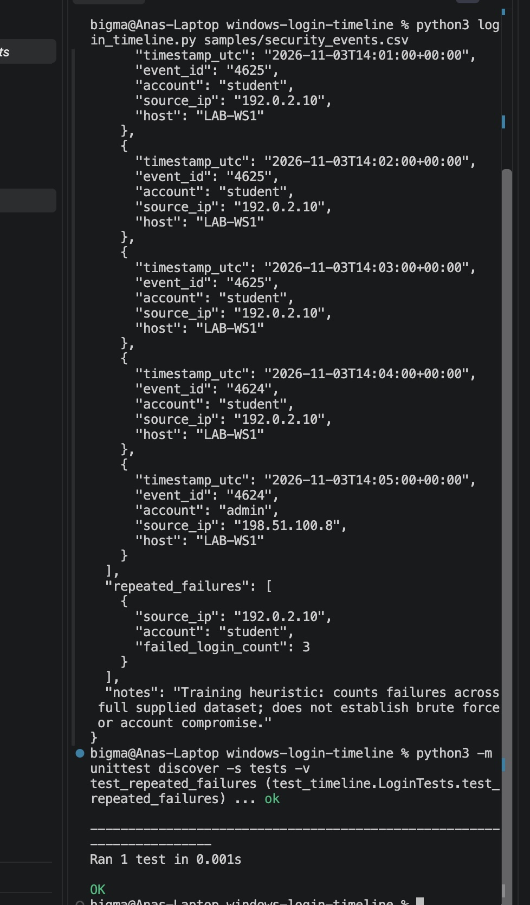

# Digital Forensics Portfolio Project

> Educational demonstration using **synthetic evidence only**. No real person's data is included. Results require analyst validation and should not be treated as proof of wrongdoing.

## Skills demonstrated
Windows Security Event IDs 4624/4625, CSV event parsing, UTC timeline construction, simple login anomaly triage, Python unit tests.

## Run (Python 3.9+; standard library only)
```bash
python login_timeline.py samples/security_events.csv --output timeline.json
python -m unittest discover -s tests -v
```

## Evidence handling
All example files are fictional. Preserve originals, verify hashes, document timestamps/time zones, and maintain a chain of custody before using any process in a real investigation.

## Limitations
Accepts a **simplified CSV export**, not native .evtx files. Count-based heuristic has no time window or exclusions; investigate legitimate causes of failed logins before making conclusions.

## Suggested next steps
Add screenshots from your own run, a sample investigator report, and a brief explanation of what you learned. Only list forensic tools you have personally operated.


## Windows Security Event Investigation Results

### Case Overview

**Case ID:** WIN-LOG-001

**Investigation Type:** Windows Authentication Log Analysis and Incident Timeline Reconstruction

**Evidence:** Synthetic Windows security event dataset (`security_events.csv`)

**Tools Used:** Python 3, Visual Studio Code, GitHub, Python unittest

### Investigation Objective

The objective of this investigation was to analyze Windows authentication events, reconstruct a chronological security timeline, identify repeated failed login attempts, and document potential indicators of suspicious account activity.

### Methodology

1. Imported a synthetic Windows security event CSV file into a Python analysis program.
2. Examined Windows Event IDs 4624 (successful logon) and 4625 (failed logon).
3. Reviewed timestamps, account names, source IP addresses, and host information.
4. Reconstructed the authentication event timeline.
5. Identified repeated failed login attempts associated with the same account and source IP address.
6. Executed an automated unit test to validate the analysis results.

### Findings

**Dataset Summary**

- Total security events: 5
- Failed login events (4625): 3
- Successful login events (4624): 2
- Host examined: `LAB-WS1`
- Investigation date represented in sample: November 3, 2026

**Finding 1 — Repeated Failed Login Attempts**

The Python analysis identified three failed login attempts associated with:

- Account: `student`
- Source IP: `192.0.2.10`
- Failed login count: 3

The repeated failures occurred within a short period and warrant further investigation to determine whether they represent user error, automated authentication attempts, or another cause.

**Finding 2 — Successful Authentication Events**

The sample dataset also contained two successful login events, including activity involving the `student` and `admin` accounts.

A successful authentication event following failures can warrant further examination, but the available sample data does not establish that an account was compromised.

### Automated Testing

The Python unit test completed successfully.

- Tests executed: 1
- Tests passed: 1
- Result: OK

The test confirmed that the program processed five security events and identified three repeated failed logins in the supplied sample.

### Conclusion

This investigation demonstrated a repeatable approach to analyzing Windows security event records, reconstructing authentication timelines, and identifying patterns requiring further security review.

The exercise strengthened practical skills in Python programming, event log interpretation, incident analysis, and forensic documentation.

**Limitations:** This project uses synthetic CSV data rather than raw Windows EVTX evidence. It does not independently authenticate log sources, confirm brute-force attacks, or establish account compromise. Additional records and contextual investigation would be needed to reach those conclusions.

## Investigation Screenshots

The following screenshot documents the execution of the Windows authentication analysis and successful automated test.


